#  Arsenale reference

The full manual. The short version is the [README](../README.md).

**Hire agents. Watch them work. Stay in charge.**

Arsenale is a local dashboard and a small run log for AI assistants. Your
assistant (Claude Desktop, Claude Code, Cursor, VS Code, Codex, Gemini CLI,
Aider, your own scripts) logs what it starts, each step it takes, what it asks
you and what it delivers; the dashboard draws it live as an office floor, a
campus of offices, an org chart, an activity log, and the questions waiting
for you.

Since 1.0 it is also for people who are not developers: a first-start wizard
sets up offices from ready-made **office packs** (marketing, research,
operations, HR, finance, customer support, design), your assistant connects
through **MCP** and logs its work by itself, and you give it **tasks**, hire
and edit **team members** with a form, approve what it asks, and browse what
it **delivered**, in plain words.

It is named after the Arsenal of Venice, where specialist departments under
one management built ships in parallel, each at its own station, with the whole
yard visible from one place.

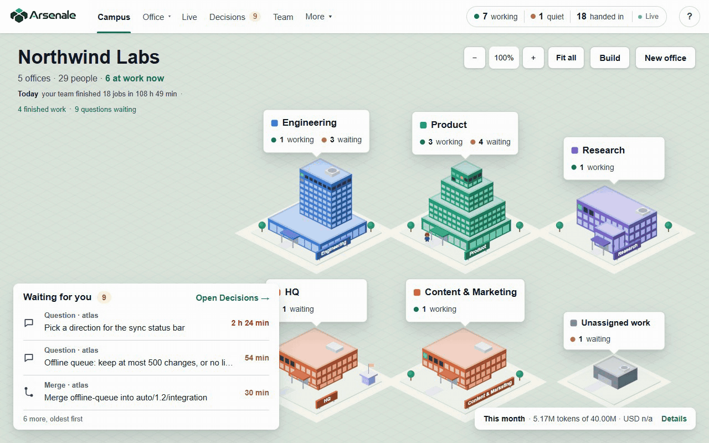

## Your AI team at a glance

You, your assistant, and the offices with the people who work in them:

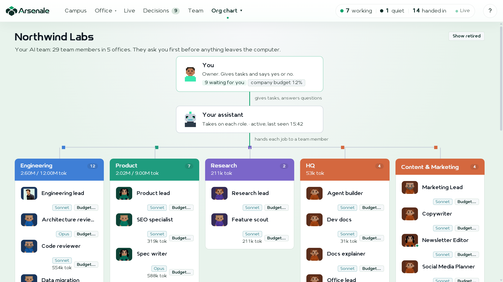

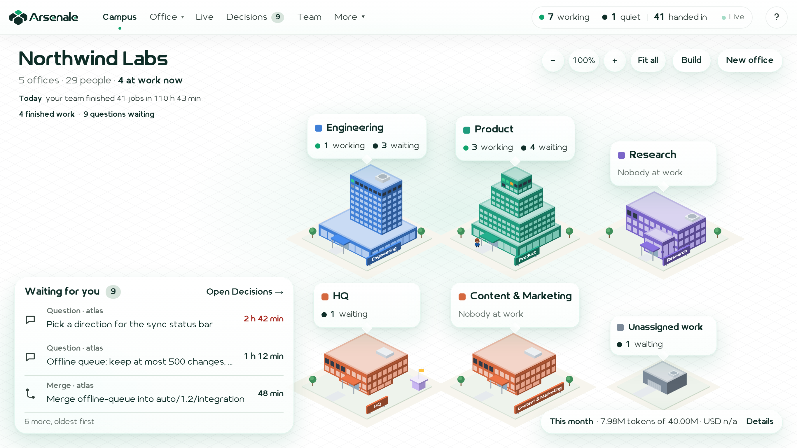

## What it is, and what it is not

- **It watches. It never runs agents.** Arsenale does not start, stop, pause
  or prompt an agent, and the server never starts a process. Your coding tool
  does the work; Arsenale shows it. (Tools like Paperclip launch and schedule
  agents themselves; Arsenale is deliberately the other half: the window.)
- **It works with any assistant.** The core is a library that writes JSON
  files, with three doors: the command line, an MCP server, and the page.
  Assistants that speak MCP log by themselves; others get a short block of
  instructions (or, for Claude Code, optional hooks). See [adapters/](../adapters/).
- **It is local.** One folder of JSON files (`~/.arsenale`), a server on
  `127.0.0.1` only, no accounts, no telemetry, no dependencies beyond
  Node.js. It makes no network call at all unless you turn on a phone channel
  (experimental, below); then only to the service you chose.
- **A team member is a role, not a second AI.** In chat assistants such as
  Claude Desktop, a team member is a role brief your assistant reads (through
  MCP) and follows for one task, logging the job under that name. Only Claude
  Code can also run team members as separate sub-agents. Arsenale does not
  give you seven AIs working in parallel in one chat window.
- **It ships with an agent team** (`agents/`): 25 agents in
  all: 21 specialists (implementer, tester, code-reviewer, security-reviewer,
  ui-designer, …), an office lead and three heads (engineering, product,
  research). Besides the core team, 16 more office packs (17 in all) ship in
  `packs/`. Shared rules
  and a development cycle with three human gates. Use them, or bring your own;
  the dashboard draws whatever agents you have.

## Quick start

You need [Node.js](https://nodejs.org) 22 or newer and git.

```
git clone https://github.com/emadbarandan/Arsenale-Ai-Agent-Company.git
cd Arsenale-Ai-Agent-Company
node bin/arsenale.cjs demo
```

`demo` opens the dashboard on an invented company, in a temporary folder that
is deleted when you stop it with Ctrl+C. It never reads or writes your own data.
`demo --shop` shows the same company as a small shop with no developers: four
office packs, named team members, tasks, questions and finished work.

To install it for real, run the installer. It asks before every change outside
its own data folder; `--dry-run` shows the plan first.

| | Command |
|---|---|
| Windows (PowerShell 5.1 or 7) | `powershell -ExecutionPolicy Bypass -File .\install.ps1` |
| macOS, Linux, Git Bash | `./install.sh` |

The installer creates `~/.arsenale` with the `arsenale` command in its `bin`
folder, offers to put that folder on your PATH, and offers to set up each
coding tool it finds. Then:

```
arsenale serve            # http://localhost:4310, opens your browser with your key
arsenale serve --port 5000 --no-open
arsenale open             # open the running dashboard again (a new browser, cleared cookies)
```

### Per tool

| Tool | What to do |
|---|---|
| Claude Code | say yes when the installer asks: agents, `/feature` and `/fix` skills, a block in `CLAUDE.md`. Optional hooks: [adapters/claude-code](../adapters/claude-code/) |
| Codex CLI | say yes: a block in `~/.codex/AGENTS.md`. [adapters/codex](../adapters/codex/) |
| Gemini CLI | say yes: a block in `~/.gemini/GEMINI.md`. [adapters/gemini](../adapters/gemini/) |
| Cursor | copy one rule file per repo. [adapters/cursor](../adapters/cursor/) |
| Aider | log around the session from your shell. [adapters/aider](../adapters/aider/) |
| Scripts, CI, anything | shell functions or plain JSON files. [adapters/generic](../adapters/generic/) |

## Connect your assistant (MCP)

`arsenale mcp` is an MCP server on standard input and output, with no
dependencies. Open **Settings → Assistants** on the dashboard: each
client has a card with the exact command, link or snippet, shows it to you
before anything is written, and has a **Test** button that turns green when
your assistant says hello.

| Client | How | Status |
|---|---|---|
| Claude Desktop | adds `mcpServers.arsenale` to `claude_desktop_config.json` after you see the change; a backup is kept | supported |
| Claude Code | copy `claude mcp add --scope user arsenale -- <node> <arsenale>/bin/arsenale.cjs mcp` | supported |
| Cursor | an "Open in Cursor" link, or `~/.cursor/mcp.json` | experimental |
| VS Code (agent mode) | an "Open in VS Code" link, or the user `mcp.json` | experimental |
| Codex CLI | `codex mcp add …`, or `~/.codex/config.toml` | experimental |
| Gemini CLI | `~/.gemini/settings.json` | experimental |
| Other MCP clients | the command, or MCP over HTTP (below) | — |
| ChatGPT | not connectable: it needs a server on the public internet, and Arsenale stays on your computer | help wanted |

"Supported" and "experimental" are both untested against each client's current
release in this repository's CI; "experimental" means the snippet follows the
client's documentation and has not been tried by hand either. Use MCP or the
Claude Code `CLAUDE.md` block with hooks, not both: both log every job twice.

What the assistant can do through MCP: say hello, start a job, log a step,
finish with a plain summary, ask you a question, read your answers and its
inbox, read, create and update tasks, comment, register a deliverable, record
a decision, check an action against the safety rules, check a budget, read the
team and a member's brief, and propose a hire. What it cannot do, whatever it
is told: answer or approve questions, change budgets, pause anyone, hire,
install packs, change the safety rules or notification settings. Those have no
tool, and an argument such as `"by":"board"` is refused.

**MCP over HTTP** (optional, for clients that take only a URL): set
`ARSENALE_MCP_TOKEN` to a random value of 32 or more characters before
`arsenale serve`; the endpoint is `http://127.0.0.1:<port>/mcp`, needs
`Authorization: Bearer <token>` on every request, refuses other web pages'
Origins, and allows 20 calls a second. Without the variable it is off.

## How it works

```
 your coding tool                      Arsenale                         you
 ─────────────────                     ────────                         ───
 main session ──── arsenale start ───▶ ~/.arsenale/agent-runs/*.json
   └ sub-agent ─── arsenale progress ▶   (one file per run, gate,       ◀── browser:
   └ sub-agent ─── arsenale finish ──▶    decision; JSON, append-only)       http://localhost:4310
 main session ──── arsenale gate ────▶                                   │
 main session ◀─── arsenale answers ── answers.jsonl ◀── your answer ────┘ (two clicks)
```

1. The main session logs each run (`arsenale start`, then `finish`), the agent
   adds one progress line per step, and questions for you become gates.
2. `arsenale serve` reads the folder and serves the page. The page asks for
   changes every 1.5 seconds; while nothing changed on disk the answer is an
   empty `304`, so an idle tab costs almost nothing.
3. When you answer a gate on the page, the answer lands in `answers.jsonl`.
   The main session reads it with `arsenale answers` at its next turn. The page
   cannot reach your agents in any other way.

With Claude Code, the dashboard can also read each sub-agent's transcript
(only inside the folders you allow) to count its tool calls, files touched and
tokens.

## The screens

The screens below are from `arsenale demo`: an invented company, so nothing of yours is shown.


| | |
|---|---|
| 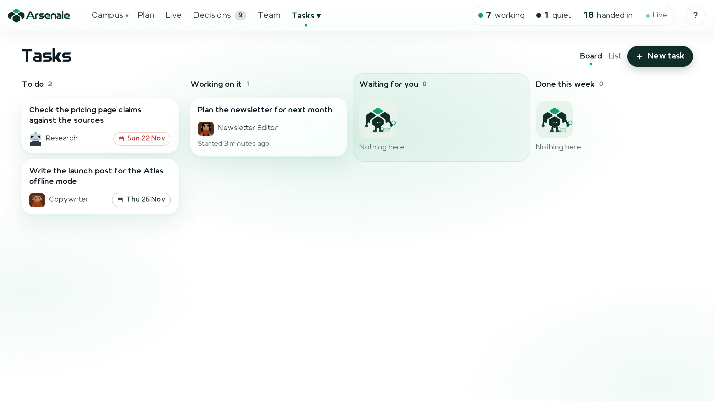 **Tasks**: a board of what you asked for (To do, Working on it, Waiting for you, Done this week), or a list. A question your team asks shows on its task. **New task** is a page of its own: what you need, who should do it, when, and whether you want to check it first. Writing a task starts nothing: your assistant picks it up the next time you talk to it. | 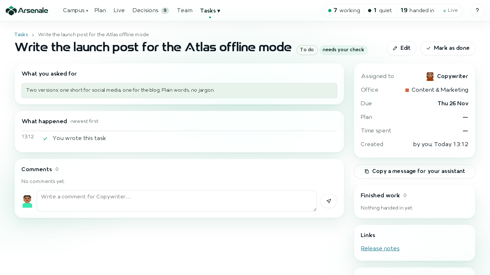 **A task**: the question waiting for you with its buttons, what happened (newest first), comments, the finished work, and the time spent; the task number and tokens only under Details. |
| 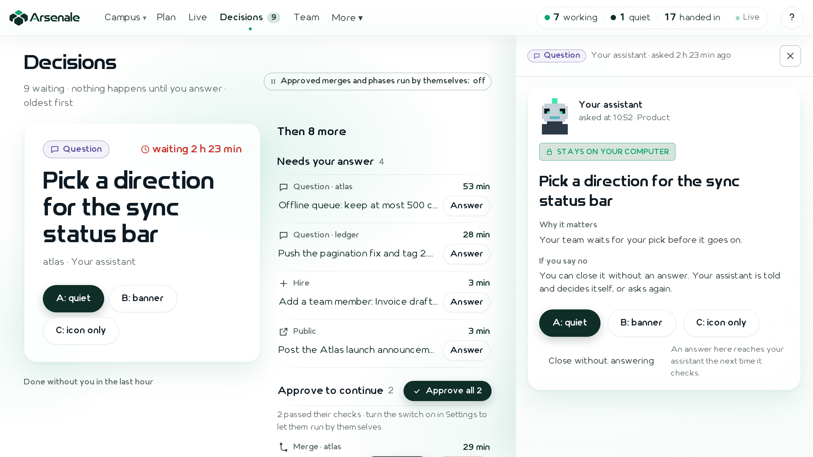 **A decision** (**Details** on the Decisions page): one letter at a time, who asks, the question in plain words, what would happen, why it matters, what happens if you say no, and whether it leaves your computer. Two clicks to answer; or ask for a change. | 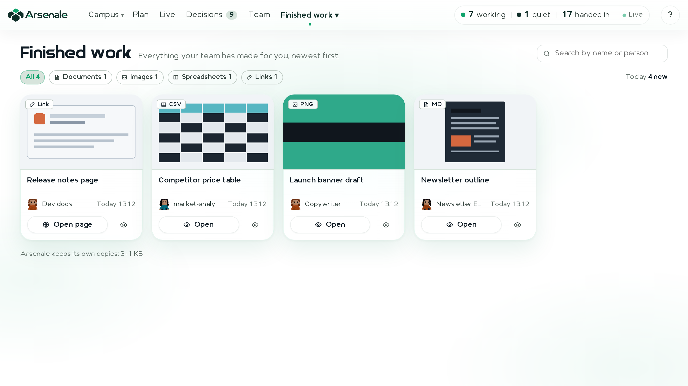 **Finished work**: documents, images, spreadsheets and links your team handed in, searchable by name or person, with previews from Arsenale's own copies. |
| 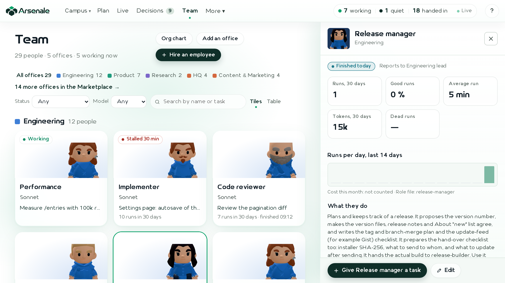 **Team**: a table of everyone, grouped by office, with status, current task, runs and tokens; the offices are chips above it, and a row opens the profile at the side (right now, this month, good at, asks you first before). | 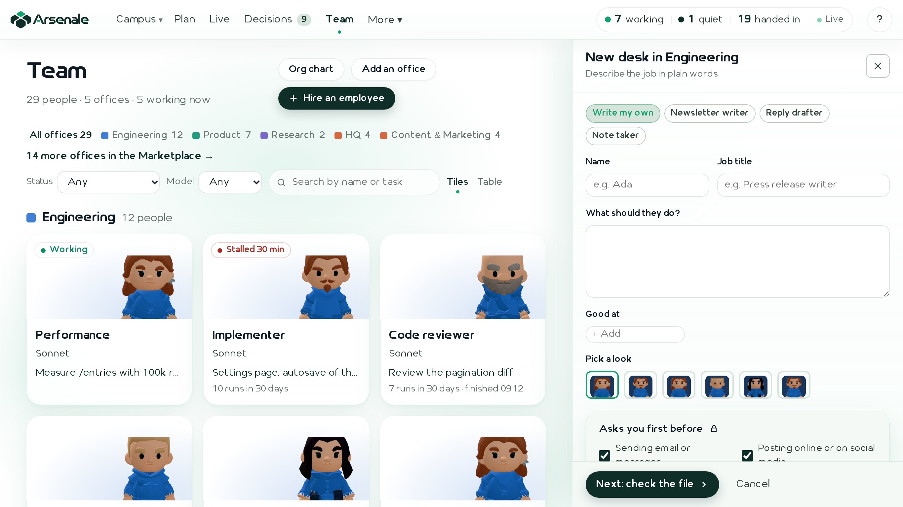 **New desk**: hire in plain words (name, job title, what they should do, good at, a look, what they ask first), then check the file before it is written; edits keep a backup. |
| 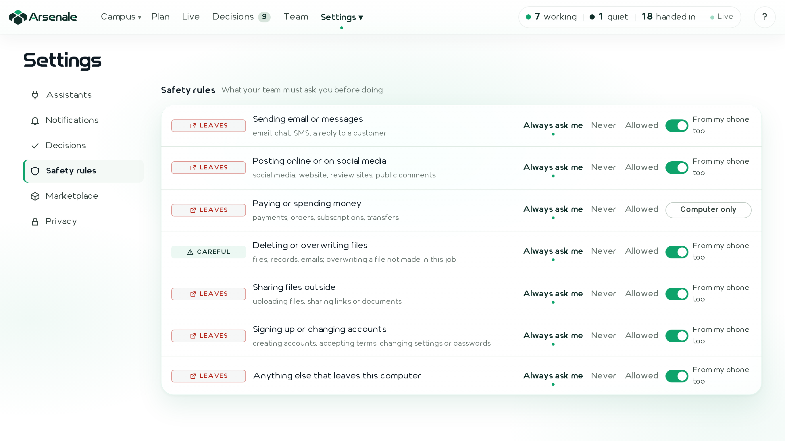 **Settings**: Assistants (connect in three steps), Notifications, Decisions, Safety rules in plain words, Marketplace, Privacy. | 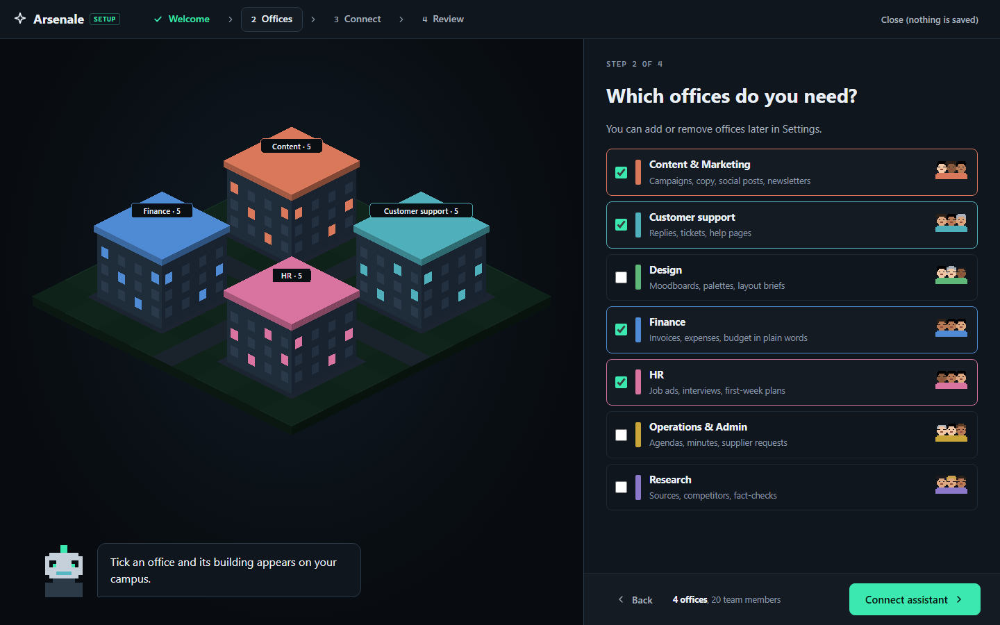 **First start**: four steps (welcome, offices, connect, review) while your campus builds itself on the left; nothing is saved before the last one. |


The screens from before 1.0:

| | |
|---|---|
| 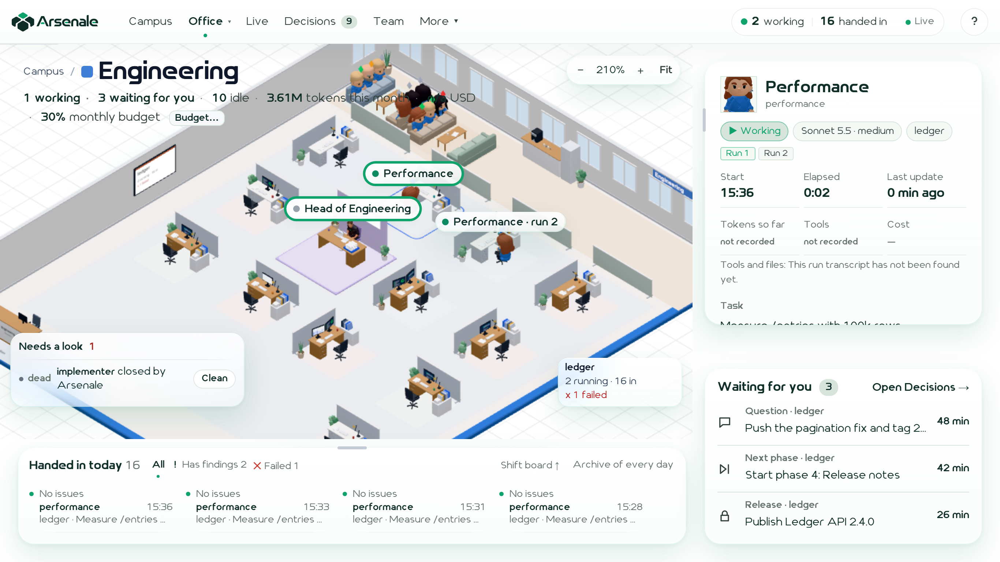 **Office**: one floor per office; agents at their desks with what they are doing now, reports landing on the lead's table, the shift board below. A quiet, stalled or dead run wears a small pill, and a **Needs a look** box offers **Nudge** and **Clean**. | 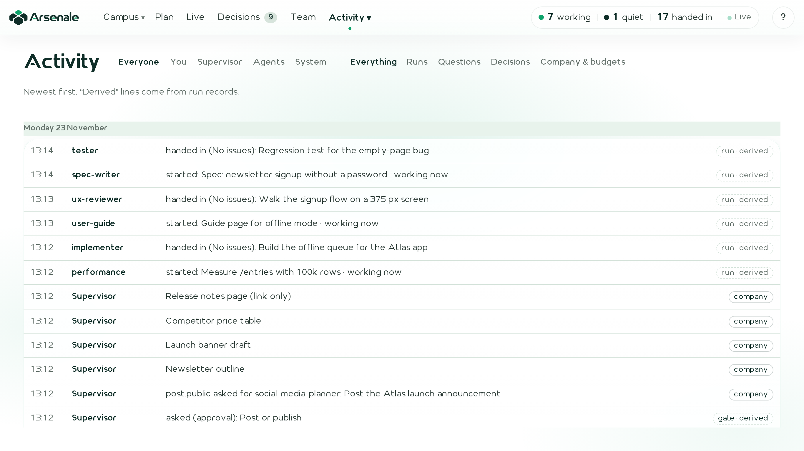 **Activity**: who did what and when, grouped by day, filterable; company changes from the log, everything else derived from the runs. |
|  **Campus**: one building per office, budgets and questions on the right. | 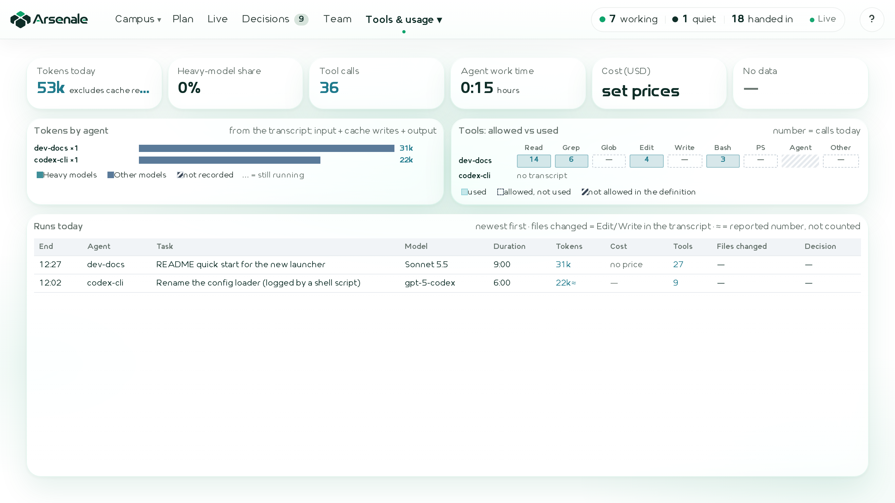 **Tools & usage**: tokens by agent, tools allowed against tools used, today's runs. |

The 1.1 screens:

| | |
|---|---|
| 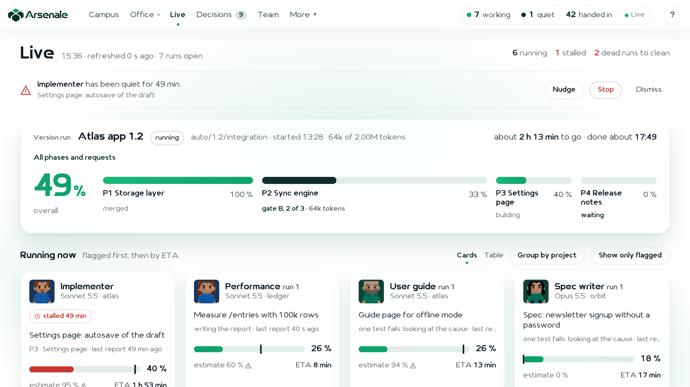 **Live**: every run working now, with its step, percent and time left; a stalled run is flagged on top. | 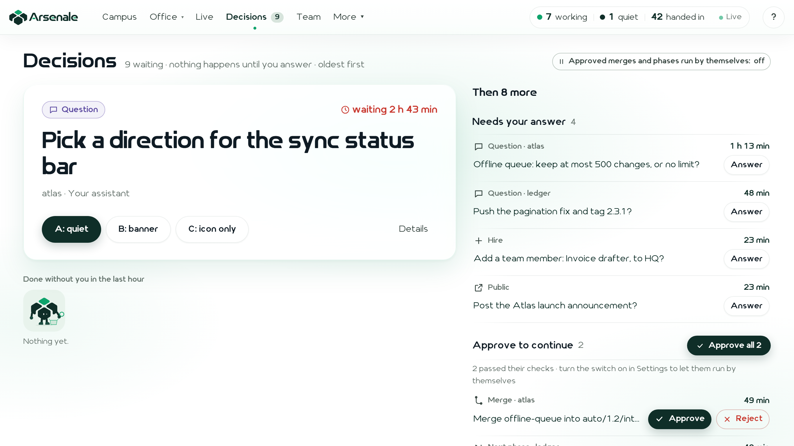 **Decisions**: every waiting question and approval in three columns. |
| 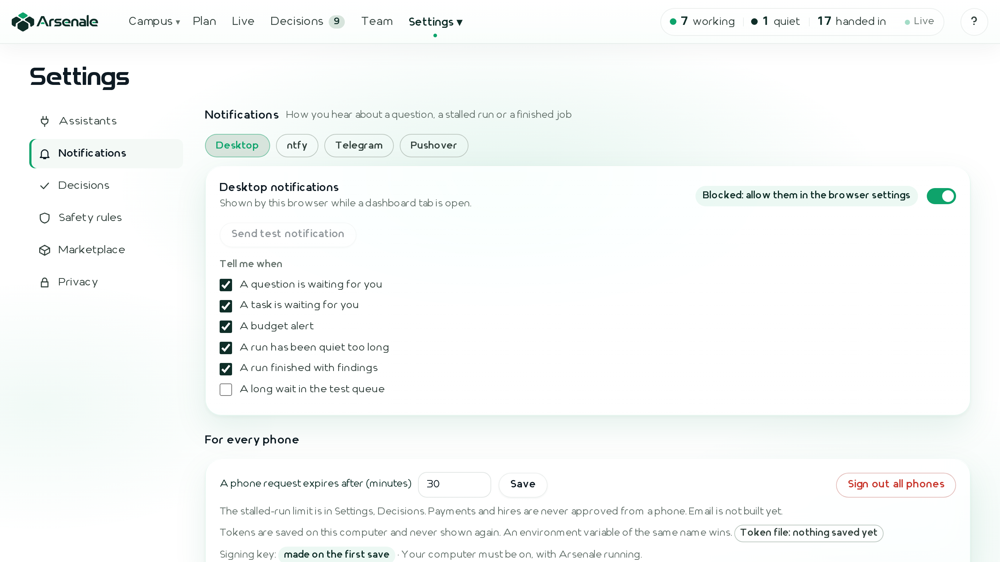 **Settings, Notifications**: one tab for each way to be told, with its own test. | 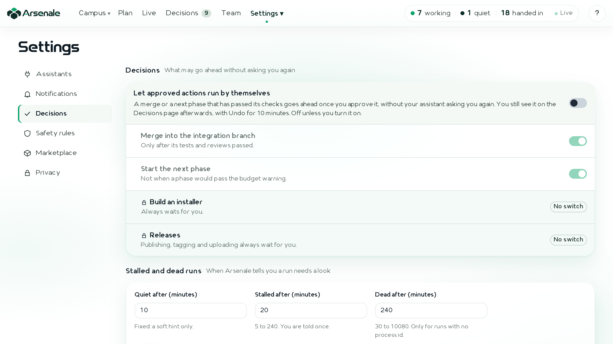 **Settings, Decisions**: what may go ahead by itself, and when a run counts as quiet, stalled or dead. |

- **Live** (`#/live`): one row per working run, with the agent, the task, the
  step, the percent (reported, or estimated and marked "est."), files changed,
  last activity, time so far and the time left; the version run's overall
  percent on top; the test queue (who holds the suite, who waits); unfinished
  work with Resume and Dismiss; and the closed dead runs with Clean. A run quiet
  for 10 minutes is amber, for the stall limit red; a run waiting in the test
  queue is never quiet. A stalled run shows a bar at the top with **Nudge**
  (asks your supervisor to check on it) and **Stop** (asks it to end the run;
  Arsenale stops no process itself). **All phases and requests** opens the
  Version run page.
- **Decisions** (`#/inbox`; `#/approvals` still opens it): every waiting question and
  approval in three columns (needs your answer, approve to continue, always
  waits for you), the evidence behind **Details**, and "Done without you": what
  ran by itself in the last hour, with **Undo** for 10 minutes.
- **Team** (`#/team`): a table of everyone, grouped by office, with status, the
  current task, runs today and last active; search and filters; a row opens the
  profile.
- **Settings**: Notifications (desktop, ntfy, Telegram, Pushover) and Decisions
  (the auto-run switch, the stall and dead limits) next to Assistants, Safety
  rules, Marketplace and Privacy. The Marketplace entry shows the bundled
  gallery and links to the Marketplace page.

The 1.2 look ("Stage"; the screenshots above are from 1.1 and are re-made
later):

- **One light theme, stronger**: a tinted ground, white cards with two soft
  shadows, bolder office colours, and a larger type scale. Nothing you must
  read is smaller than 13 px. Arial only.
- **The top bar** shows the logo, five screens (Campus, Office, Live,
  Decisions, Team) and **More** (Tasks, Finished work, Activity, Org chart,
  Gate history, Details: tools & usage, Marketplace, Settings), one status
  group, and **?**. Legends and help notes are hidden behind **?** until you
  show them.
- **Waiting for you** is a small card over the campus and the office with the
  oldest three items in plain words (Merge, Next phase, Release, Hire,
  Question, and how long each waits). It opens the full list, where the
  "Gates per project" strip names each gate in words (Questions, Design pick,
  Commit) instead of letters. Reject still stores `decline`.
- **Team** opens as tiles of people (or the table, remembered), with the
  rendered portraits; a row or a tile opens the profile. The packs you have
  not added are one link: "N more offices in the Marketplace".
- **Marketplace** (`#/marketplace`, under More): the packs that ship with
  Arsenale, and a pack from a folder or a `.zip` (see
  [Office packs](#office-packs)).
- **A narrow layout** at 360 to 480 px wide, one column per screen, for 9:16
  recordings. The dashboard still serves only this computer.

Also: **Gate history** (`#/decisions`, under More: a timeline of who decided
what), an **archive** of every run. The interface is English only.

### Desks

Every agent you have gets a desk, whatever it is called: the zone comes from a
`zone:` line in its definition (`build`, `review`, `docs`, `design`), else from
its name (`…-reviewer` reviews, `ui-…` designs, `…-docs` writes), else build.
A floor has 18 desks; more agents than that take a guest desk while they work.

### The campus and the 3D office

**The campus** is a board of lots on a grid (6 by 4 to begin with), one building per
office, drawn as isometric buildings in the office's colour on a tinted ground, with a
card for each office above its building (its name, who is working and who waits; the
month's spend, the budget and **Enter office** on hover or focus). Only the lots in use are on show; the first
offices of an older company start as a block three lots wide. The office profile
selects one of 12 building types (engineering, verification, security, release,
docs, design, data, planning, legal, business, archive hall, domain lab). The
shape comes from the size of the office: 8 or more desks is a tower (a slab on a
podium, or a stepped tower), 4 to 7 a glass block (with a cantilever over the
lobby, or with a low wing), 3 or fewer a long bar with a glass atrium. Each has
rows of windows, a door under a flat canopy and the office name on a sign; the
type picks the variant, keeps its colour band and what stands on the roof (a
tank, a mast, solar panels). A tower never rises over the name sign of the lot
behind it. A window is one employee, lit in the colour of their state. Click a building to enter its office. **Build** opens build
mode, with every lot of the grid outlined: a hotbar of the 12 types (keys 1 to
9), a tool column (select, move, rotate, archive), a ghost building that follows
the pointer (blue on a free lot; red with "Lot taken: <office>" on a used one),
**R** to turn (a turned building is drawn from the other side), **Delete** to
archive (twice, so a stray key does nothing), **Done building** to leave. **New
office** (next to **Build**, and **Add an office** on Team) opens the form described
in [Offices you make](#offices-you-make). Move is
two clicks: the building, then its new lot. Placing a building creates its office;
archiving one archives the office and keeps its history. The layout is
`company/campus.json` (see `tools/campus.cjs`); without the file it is derived from
the offices, and nothing is written until the first change. The supervisor may
place, move, turn and remove buildings with `arsenale campus <json>` in an
autonomous run only; each change is also written as a decision. An agent cannot
change the campus.

**The office floor** is a bright 3D room: a work station for each person round the
supervisor's station, a lounge where idle people rest, a reception, windows and
the project screens. People walk between them as their state changes (lounge,
supervisor, desk, supervisor, lounge). A small one-line pill beside the head (a
dot in the colour of the state, and the name; the state word is its tooltip) shows
only for people who are working, waiting, quiet, stalled, dead or failed; a free
or finished person shows the name only on hover, focus or selection. No pill
covers a head. Pills of one state that sit close together fold into one counter
chip ("3 working") that opens on hover; the supervisor's tray shows the number of
reports handed in as a small badge, and nothing while it is 0. In the demo's
showcase at most four pills show (stalled, then waiting, then working). The
details open in the side panel. A **Needs a look** box lists the floor's stalled runs (**Nudge** asks the
supervisor, through its inbox, to check on the run) and the dead runs Arsenale
closed (**Clean** hides one from the office and Live; its log stays in Activity).
The side panel of such a run has the same button. A run is a person: two runs of one agent are two
people at two desks ("implementer" and "implementer · run 2"), and a run keeps its
desk for its whole life. Drag to pan, right-drag to orbit, wheel to zoom, click a
desk to fly to it, **Fit** (or Esc) for the whole office; the camera stays where you
left it through every redraw. Without WebGL, and in the built file, the office
stays the flat isometric one.

- **three.js r184**, pinned and served from the page itself, never a CDN:
  `tools/vendor/three/` (MIT, see `three-LICENSE.txt` and the `README.md`
  there).
- **The people** are the KayKit characters by Kay Lousberg (Adventurers 2.0 and
  Character Animations 1.1), both **CC0 1.0**: `tools/characters/person-1.glb` to
  `person-5.glb`, and `person-plain.glb` (the mannequin) as the plain one. The
  build script (`build-characters.cjs`) left out the costume props, recoloured the
  outfit to a neutral shirt that the page tints in the office colour, and kept six
  clips: Idle, Walk, Sit, Typing (made from the seated idle), Stand and Celebrate.
  A person keeps the same character everywhere: the `look` number in
  `employees.json`, else a hash of the id, picks it.
- **The licence record** is `tools/characters/manifest.json`: the source page,
  the download date, the original file and its SHA-256, the shipped SHA-256 and
  what was changed, for every file; `LICENCES.md` says the same, to read. A test
  fails when a shipped file does not match its entry.
- **Sprites and portraits** for the campus, the flat office and the lists (Team,
  Live, Tasks, the panels) are rendered from the same models by
  `node tools/characters/build-sprites.cjs` (headless, one picture per character
  and office colour, in `tools/characters/sprites/`). Run it again after a change
  to the office colours. Without the sprite files the pixel people come back.
- **The fallback character** is `tools/characters/default.glb`, made from three.js
  primitives by `tools/characters/make-default-character.cjs` (our own work, CC0).
- **Your own characters**, one per person: drop a `.glb` on their desk (kept in
  that browser), use **Load .glb…** in the details panel, or put
  `<agent-name>.glb` in `ARSENALE_HOME/characters/`. See
  [`tools/OFFICE-WORLD-NOTE.md`](../tools/OFFICE-WORLD-NOTE.md).

## Office packs

Seven packs ship in `packs/`: Content & Marketing, Research, Operations &
Admin, HR, Finance, Customer support and Design, each with a lead and 3 to 4
members (33 in all). Every member prepares drafts and never sends, posts, pays,
orders or deletes by itself; HR and Finance members say that their output is a
draft for a qualified person, not legal, tax or employment advice.
Instructions are written for any assistant, with no tool or vendor names. The
pack texts have not yet been reviewed by an HR or finance professional.

Install and remove packs in the **Marketplace** (`#/marketplace`; the
Marketplace entry in Settings shows the same gallery and links to it), or pick them in the
wizard. Files go into Arsenale's own folder, `~/.arsenale/agents`; a member
whose name you already have is never overwritten (keep yours, or install a
copy); removing a pack deletes only the files you did not change and archives
the office, with all history kept. The format is in
[packs/README.md](packs/README.md).

### A pack from a folder or a .zip

A pack someone gave you installs from **Marketplace → Install from a folder or
.zip…**. A pack is instructions your assistant will follow, so it can carry
prompt injection; Arsenale checks that it is only text, shows you all of it,
and gives its members read-only tools unless you keep theirs. It marks the
pack "From a folder: not checked by Arsenale". There is no online catalogue,
and no command-line or MCP way to install one.

**The format** is the bundled one (`pack.json`, `labels.json`, `README.md`,
`agents/<member>.md`), with these limits:

| Rule | Limit |
|---|---|
| Files | only `pack.json`, `labels.json`, `README.md` and `agents/<member>.md`; every path must match `^(pack\.json\|labels\.json\|README\.md\|agents/[a-z][a-z0-9-]{1,59}\.md)$`. A `.zip` may wrap them in one top folder. Anything else is refused: scripts, `.js`, `.exe`, `.txt`, hidden files, other folders |
| Text | UTF-8, no NUL byte; a member file must not start with a byte-order mark |
| Sizes | each file 64 KB, the whole pack 1 MB, at most 200 entries, 1 to 24 members, a member file for every member and none other |
| Paths | no `..`, no absolute path, no drive letter, no backslash, no name Windows reserves (`con`, `nul` …) |
| `.zip` | read by Arsenale's own reader (no other program runs): one disk, no ZIP64, no encryption, stored or deflated only; links and special files refused; sizes checked from the directory before inflating and again while inflating (a zip bomb stops at the limit); no overlapping or duplicate entries; checksums must match |
| `pack.json` | the bundled checks (`formatVersion` 1, ids, zones, stricter-only policy), plus: no `__proto__`, `constructor` or `prototype` key anywhere (also in `labels.json`); not the id of a bundled pack; no `core` or `ref` members; its office id is not an office your company already has |
| Member files | a frontmatter of single `key: value` lines between `---`, only the keys `name`, `description`, `model`, `effort`, `tools`, `color`, `zone`, each once; `name` is the member id |

Any failure refuses the whole pack and lists every reason.

**The install steps.**

1. **Stage.** The page uploads the files themselves (base64), never a path;
   the server writes them to `<data>/packs/staging/<random>/` and checks only
   that copy. A review left open is removed after an hour, and at the next
   start of the dashboard.
2. **Review.** You see the pack id and version, the office it adds, each
   member with its title, zone, model, its declared `tools:` line, what
   read-only would drop, and its full text; the stricter safety rules; the
   sample tasks; the README as plain text; every file and its size. Flags
   point at tools beyond reading, a missing `tools:` line, a `model:` line,
   web and e-mail addresses, words that try to override the rules, and
   instructions to send, post, pay, delete or upload. Flags are hints, not a
   guarantee.
3. **Install,** on your click only, through the owner-only write path (the
   page's Origin, its token, `Sec-Fetch-Site`, a 2 MB body cap). The staged
   copy is checked again and must match the reviewed hash. Each member is
   written with `tools: Read, Grep, Glob` unless you ticked **Keep the pack's
   tools** for it: in Claude Code a member file with no `tools:` line gets
   every tool, so a missing line is added, not left out. The `tools:` line
   protects only where the assistant honours it, and that is Claude Code
   subagents. Other assistants read the file as plain instructions and may
   ignore the line; there, the only protection is the text you reviewed. The pack's copy moves
   to `<data>/packs/local/<id>/<version>/`.

**Remove** deletes exactly the files the install wrote (by their SHA-256 in
`installed.json`), the pack's copy under `packs/local/`, archives its office
and retires its members (history stays; the stricter rules and the desk
labels stay, as for a bundled pack). If you changed one of its files, it asks
first, and keeps that file. **Update** takes the same id with a higher
version, through stage and review again; unedited files are replaced, and the
new text of a file you edited goes to `<data>/pack-updates/`.

`installed.json` marks such a pack with `source: "local"`, `localDir`,
`reviewedAt` and `toolsKept`; an entry without `source` is a bundled pack.
Arsenale 1.1 ignores these fields: it does not list a local pack, but its
members keep working and its writes keep the entry as it is.

## Safety rules

`~/.arsenale/policy.json` says, for each kind of action that leaves your
computer (send a message, post or publish, pay or buy, delete or overwrite,
share outside, change accounts, anything else), whether a team member may do
it, must **ask you first** (the default for all of them), or must never do it.
The assistant calls `check_action` (or `arsenale check-action`) first; "ask"
puts an approval on your dashboard.

This is advisory, and every screen says so: Arsenale asks your assistant to
check and records what happened, but it cannot block a tool inside another
program. To block an action for certain, also switch it off in your
assistant's own settings. Payments are never approved from a phone.

## Notifications

While the dashboard is open in a tab, your browser can notify you of a new
question, a task waiting for you, or a budget alert (Settings → Notifications;
on once you allow it in the browser).

**On your phone (experimental):** ntfy and Telegram can carry Approve /
Reject buttons, Pushover only notifies. They are off until you set them up and
a test arrived. By default a phone message says only "Arsenale: 1 question
waiting"; the question text and buttons need "details mode", which names the
service that will see the text. Each button carries an HMAC-signed, single-use
token that expires after 30 minutes and dies if the question changes. On an ntfy server that is not on this computer and has no access token, a typed topic needs at least 20 characters and buttons go only to the generated topic, since anyone who guesses a topic can read it. An approval to build or publish a release never gets buttons: it is answered on the computer. The
dashboard picks the tap up over its own outbound connection; no port is
opened. The channels have been tested against their protocol in this
repository, not yet on real phones. Email is not built yet.

**Stalled runs.** When a run has been quiet for the stall limit (20 minutes by
default), the dashboard server sends one alert to each phone channel that is
on: "A run has been quiet for 20 min". The agent name is added only when the
channel's details mode is on; the task, steps and paths never leave the
machine. A dashboard tab raises the desktop notification. Alerts need the
dashboard server running.

**Secrets.** The tokens are typed in Settings and saved in
`<data>/notify/secrets.json`, written atomically. The page and the API show
only whether each one is set and where from, never the value; no log or
activity line holds one. On macOS and Linux the `notify` folder is mode 0700
and every file in it (secrets, config, pending buttons, used nonces) is 0600,
checked at every write. On Windows every `arsenale serve` reads the folder's
access list (`icacls`) and, when it is not limited to your account alone,
limits it again; the page shows the access list it finds, not a remembered
mark. Each phone button is signed for one channel and refused on any other.
An environment variable of the same name wins
over the file: `ARSENALE_PHONE_KEY` (32+ characters, signs the buttons; made
for you at the first save when neither exists), `ARSENALE_NTFY_TOKEN`
(optional), `ARSENALE_TELEGRAM_TOKEN`, `ARSENALE_PUSHOVER_TOKEN` and
`ARSENALE_PUSHOVER_USER`.

### Notifications API (dashboard)

For the Settings page; every write is the owner's only and refused for any
other actor in the library.

`GET api/notify` answers:

| Key | What |
|---|---|
| `secrets` | `{phoneKey, ntfyToken, telegramToken, pushoverToken, pushoverUser}`, each `{set, from}`; `from` is `"env"`, `"file"` or `""` |
| `secretsFile.ownerOnly` | `true`, `false`, or `null` when no secret is saved yet |
| `events` | `{desktop, ntfy, telegram, pushover}`, each `{question, task, budget, stalled, findings, queueWait}` true/false |
| `eventDefaults` | the defaults (all on except `queueWait`) |
| `limits` | `{stallMinutes, deadMinutes, repeatMinutes}` in force |
| `expiryMin` | phone request expiry, minutes |
| `ntfy`, `telegram`, `pushover` | `enabled`, `details`, `testedAt`, `lastTest` `{at, ok, reason}`, `lastSentAt`, `lastError` `{at, reason}`; ntfy also `server`, `topic`; Telegram also `paired`, `pairedName`, `pairLink`, `pairCommand`, `pairExpiresAt` |
| `env` | the 1.0 page's view: `{key, ntfyToken, telegram, pushover}` true when set from either place |
| `readOnly` | `true` when `notify/config.json` was written by a newer Arsenale: every `POST` is refused with 409 and nothing is written |

`POST api/notify` takes `{op, channel, ...}` and answers `{ok, result}` with
the same state:

| `op` | Body | Notes |
|---|---|---|
| `setup` | ntfy: `server`, `topic`, `token`; Telegram: `token`; Pushover: `token`, `user` | a secret as a string is saved, as `null` removed, left out kept; ntfy topic is made when empty. A changed server, topic or token (the one in force: an environment variable wins) clears `testedAt` and `lastTest` and turns the channel off (with a new epoch, as `disable`): a changed target is tested again |
| `test` | `channel` | sends one test; on success `lastTest.ok` and `testedAt`; on failure `lastTest.ok: false` is kept and the call fails with the reason |
| `enable`, `disable` | `channel` | `enable` needs a successful test first |
| `details` | `channel`, `on` | |
| `pair` | `channel: "telegram"` | needs the bot token |
| `events` | `channel` (`desktop` or a phone channel), `events: {stalled: false, ...}` | only the events given change |
| `expiry` | `minutes` | |
| `signout` | | every button already sent stops working |

A refusal is `{error, field}` where `field` names the form field
(`server`, `topic`, `minutes`, `events`, `ntfyToken`, `telegramToken`,
`pushoverToken`, `pushoverUser`); the error text starts with the field's name
and says the rule: server `https://`, or `http://` on 127.0.0.1 or localhost;
topic 3 to 64 letters, digits, `-` or `_`; expiry whole minutes 5 to 1440;
tokens non-empty, no spaces, at most 200 characters. The stall, dead and
repeat limits are saved with `POST api/limits` `{stallMinutes, deadMinutes,
repeatMinutes}` (5-240, 30-10080, 0-1440 whole minutes).

### Live, Decisions and run actions API (dashboard)

The pages read these; nothing here starts, stops or ends a process. Every
`POST` takes the same checks as the other writes (the page's Origin,
`Sec-Fetch-Site` same-origin when the browser sends it, the page token, JSON
only) and is the owner's only in the library: an agent or supervisor actor is
refused.

| Route | What |
|---|---|
| `GET api/live` | the Live page: `runs` (each with `state` working, quiet, stalled or dead, `quietMin`, `inQueue`, the percents, files, step and ETA), `versionRuns` with their overall percent, `queue`, `resume` (unfinished work), `alerts`, `limits`, `automation` |
| `GET api/run-actions` | `{dead, readOnly}`: the runs Arsenale closed in the last 7 days that nobody cleaned |
| `POST api/run-action` | `{op: "nudge" | "stop" | "clean", run}`: Nudge and Stop write a line to the supervisor's inbox (Stop asks the supervisor to end the run; Arsenale never does); Clean hides a closed dead run (`run: "all"` hides every one shown), its record stays |
| `GET api/auto-log` | `{windowMin, items}`: approvals that ran by themselves in the last hour, each with `canUndo` and `undoneAt` |
| `POST api/undo` | `{gate}`: once per item, within 10 minutes of the approval; writes an `undo` line to `answers.jsonl` and the supervisor's inbox |
| `GET` / `POST api/automation` | `{autoRun, kinds: {merge, "next-phase"}}`; building and publishing have no switch |
| `POST api/limits` | `{stallMinutes, deadMinutes, repeatMinutes}` |
| `POST api/resume` | `{op: "resume" | "dismiss", run}`: Resume writes the stored brief to the supervisor's inbox |
| `POST api/alerts` | `{run}`: hides that run's stall banner until it stalls again |
| `POST api/answer` | `{gate, answer, hash}`: `hash` is the gate's `qhash` as the page showed it; an answer to a question that changed since is refused (409), and an Approve of a merge or next phase needs it |

A run id or gate id that names an `Object.prototype` key (`__proto__`,
`constructor`, `prototype`) is refused. A file written by a newer Arsenale is
read-only: the change is refused with 409.

## Companies, offices and budgets (optional)

Without a company the dashboard is one office. With one, you get a campus of
offices, projects mapped to offices, an org chart, and monthly budgets. The
first-start wizard sets one up (it opens by itself on an empty data folder);
the command line can too:

```
arsenale log --company-init --seed company.example/seed.json
```

- Budgets count tokens (and USD when you fill in `model-prices.json` in the
  data folder; it ships empty, and a cost that cannot be priced shows "n/a",
  never 0). Company, office and employee budgets each have an alert threshold
  and an optional hard stop.
- **Budgets can be switched off** company-wide in one click: usage is still
  shown, without alerts or refusals.
- A hard stop is advisory: `arsenale budget-check` exits 2, and a supervisor
  that follows the rules asks you before starting the agent. Arsenale itself
  cannot stop a running agent.

### Offices you make

**New office** (on the campus, next to **Build**, or **Add an office** on Team)
opens a form: a name (1 to 40 characters, not the name of another open office),
a colour (one of the nine named office colours), a building (one of the 12
types), the kinds of work it does, and an optional lot (else the first free
one). Nothing is written until **Create office**; Cancel writes nothing. Create
writes the office to `offices.json` and its building to `campus.json` under one
lock; if the building cannot be written, the office stays archived, so there is
never an office without a building. **Edit office** (on Team, with that office
picked) changes the name, colour, building type and kinds; a new type re-draws
the building on its lot. Archiving works as before: nothing is deleted, history
stays, and the office gives up its kinds.

Only you can create, edit or archive an office: an agent or the supervisor is
refused ("Only the owner can do this") in the library, so on every door. The
supervisor keeps its right to place a building in an autonomous run
(`arsenale campus`), which sets no kinds. MCP has no tool that changes an
office; `get_office` only reads. On the command line: `arsenale log --office`
(see `arsenale log --help`).

### Kinds of work, and where a run goes

A **kind of work** is one of a fixed list: Building software (`build`), Code
review (`review`), Testing (`verify`), Security (`security`), Writing docs
(`docs`), Design (`design`), Data (`data`), Planning (`plan`), Releases
(`ship`), Operations (`ops`), Legal (`legal`), Research (`research`), Marketing
and content (`content`), Customer support (`support`), Finance (`finance`) and
People and HR (`people`). The list is in `tools/kinds.cjs`. A kind belongs to
at most one open office ("Testing is done by Verification. Remove it there
first."). A pack may name kinds for its office (`office.kinds`); a kind that
another office holds is skipped, and the install says so.

A run's kind is the first of: `kind` on `arsenale start` (or MCP `start_job`;
an unknown kind is ignored there), the kind of its task, the member's `kind` in
`employees.json` (or its pack's), the member's desk zone (`build`, `review`,
`verify`, `docs`, `design`, `data`, `plan`, `ship`, `ops`, `legal`), or none.

A run's office is decided once, at `arsenale start`: an `officeId` named at
the start, else the office that holds the run's kind, else the project's
office, else the member's home office, else Unassigned work. It is written
into the run record (`officeId`, and `officeBy`: `explicit`, `kind`,
`project`, `home` or `unassigned`), so changing the kinds later moves no past
run and no past budget. A run recorded before 1.2 has no stamp and is placed
as in 1.1, and with no kinds on any office routing is exactly as in 1.1. A
task saved with a kind and no office gets the office a run of that kind would
get. `arsenale log --office` with `{"agent":"tester"}` says where that
member's next run goes, and why.

## Commands

`arsenale --help` lists everything. In short:

| Command | Does |
|---|---|
| `arsenale serve [--port N] [--no-open]` | the dashboard (default port 4310) |
| `arsenale open [--port N] [--no-open]` | open the running dashboard with your key; `--no-open` only prints the address |
| `arsenale demo [--port N] [--no-open] [--shop] [--showcase]` | the dashboard on invented data (default port 4311); `--shop`: a small shop with office packs; `--showcase`: for recordings, hides the Waiting for you card, the legends and the help notes (also **?** → Showcase, or `?showcase=1` / `0` on a demo page). `arsenale serve` refuses `--showcase`, and the real app never shows it |
| `arsenale start / progress / finish / gate / decision --stdin` | log a run, a step, a result, a question, a decision |
| `arsenale answers` / `arsenale inbox` | what you answered or changed on the page |
| `arsenale mcp` | the MCP server on stdin/stdout, for an assistant to start |
| `arsenale task / comment --stdin` | create or move a task, comment on one |
| `arsenale deliverable --stdin` | register a link, a file (copied only from your deliverable folders) or text |
| `arsenale check-action --stdin` | ask the safety rules before an outside action (exit 0 allow, 2 never, 3 ask) |
| `arsenale progress <run id> "<step>" [<pct>]` | a progress line for fixed text without quotes, the same as `{"id","doing","pct"}` |
| `arsenale testq run --run <id> [--repo <path>] -- <command ...>` | run a full test suite when it is this run's turn (one suite at a time on this machine); exits with the command's code. `testq status [--json]`, `testq leave --run <id>` |
| `arsenale resume-scan [--dir <repo>] [--json]` | list runs that ended without finishing and left changes in their worktree (read-only git) |
| `arsenale alerts [--json]` | stalled and dead runs now (read-only) |
| `arsenale log --help` | every logging mode, its JSON fields and exit codes |
| `arsenale paths` | where data, agents and transcripts are read |

Pass JSON with `--stdin` (a quoted heredoc in bash) or `--file`, never inline
when the text came from somewhere else:

```bash
arsenale progress --stdin <<'EOF'
{"id":"<run id>","doing":"reading src/app.ts"}
EOF
```

```powershell
Set-Content -Encoding UTF8 -Path "$env:TEMP\step.json" -Value '{"id":"<run id>","doing":"reading src/app.ts"}'
arsenale progress --file "$env:TEMP\step.json"
```

A progress line may also carry a plan and the step being done, which gives
an honest percent: send the plan once, then the step, with `pct` as that
step's own progress. `files` is the number of files changed so far:

```bash
arsenale progress --stdin <<'EOF'
{"id":"<run id>","doing":"editing the form","plan":[{"name":"read","weight":1},{"name":"edit","weight":2},{"name":"test","weight":1}],"step":"edit","pct":50,"files":3}
EOF
```

Which `pid` to record on `arsenale start`: the agent's own process, the one
that runs as long as the agent works (for an agent in a terminal, its main
process). Never the shell or the `arsenale start` command that records it:
those end at once. Arsenale fills `pidStartedAt` itself from the system where
the system tells it (Linux) and ignores a `pidStartedAt` in the input. A run
whose pid is gone is closed only when two checks in a row (30 s apart) see it
gone and the run has also been quiet for the stall limit, or its start time
came from the system; a run with no pid is closed after the dead limit.

Exit codes: `0` done, `1` failed (bad input, unknown id, port taken), `2`
`budget-check` said stop or `check-action` said never, `3` `check-action`
said ask.

## Configuration

| Setting | Where | Default |
|---|---|---|
| Data folder | `ARSENALE_HOME` | `~/.arsenale` |
| Agent folders shown | `agentDirs` in `config.json`, or `ARSENALE_AGENT_DIRS` | `<data>/agents` (the installer sets your tool's folder) |
| Transcript folders that may be read | `transcriptRoots`, or `ARSENALE_TRANSCRIPT_ROOTS` | none |
| Heavy-tier model names | `heavyModels` | `["Opus"]` |
| Run log, company and built pages kept in another folder (an existing setup) | `runsDir`, `companyDir`, `pagesDir` | `<data>/agent-runs`, `<data>/company`, `<data>` |
| Project names that mean one project | `projectAliases`: `[{"match": "<regex>", "project": "<name>"}]` | none |
| The version a bare model family meant in older records | `modelAliases`: `{"Opus": "Opus 5.5"}` | none |
| A run whose project no project claims | `unmappedRuns`: `"home"` (the member's home office) or `"unassigned"` | `"home"` |
| Desks kept where you are used to them | `desks`: `{"<agent>": ["build"\|"review"\|"docs"\|"design", <slot>]}` | by name |
| Prices | `<data>/model-prices.json` | empty |
| Folders deliverables may be copied from | `deliverableRoots` | `<data>/workspace` |
| Model per strength for hired members (Claude Code) | `tierModels` | `{"light":"haiku","standard":"sonnet","heavy":"opus"}` |
| MCP over HTTP | `ARSENALE_MCP_TOKEN` (environment only) | off |
| Phone channels | Settings → Notifications; secrets in `<data>/notify/secrets.json`, or environment variables, which win | off |

Arsenale's own team-member folder, `<data>/agents`, is always read (last), so
hired and pack members show up even when `agentDirs` names other folders.

The language your agents and supervisor use with you is set in your tool's
instructions, not here: the bundled rules say "the user's language".

## Security model

- **One write library, three doors, the actor fixed by the door.** The page
  writes as you (the Board); the MCP server always as your assistant; the
  command line as whatever its JSON says. Owner-only work (answering,
  approving, budgets, pauses, hiring, packs, safety rules, notification
  settings) is refused in the library for every other actor, not hidden in the
  UI.
- The server listens on `127.0.0.1` only, and refuses any request whose Host
  header is not `localhost` or `127.0.0.1` on its port (no DNS rebinding).
- Every request needs your key cookie. `arsenale serve` makes a random launch
  key in `<data>/launch-key`, readable only by you, and opens the page with
  it once; the page trades it for a cookie and drops it from the address.
  Other accounts on the same machine can reach the port but not the key.
- Writes from the page also need the page's Origin and a token derived from
  the key; another web site can neither read the token nor send it. Bodies are
  capped at 8 KB (32 KB for tasks and the hire form, 2 MB for a pack upload) and validated.
- MCP over HTTP is off unless `ARSENALE_MCP_TOKEN` is set; then it needs that
  bearer token, refuses foreign Origins, is rate-limited and caps bodies.
- The hire form writes only into `<data>/agents` (another tool's file only
  after you confirm), generates the frontmatter itself so typed text cannot add
  keys, always appends the safety block, and backs up every edit.
- A deliverable path is copied into the store only from your deliverable
  folders, never a protected file (keys, `.env`, licences, `.ssh`), within
  type and size limits; images are checked by their first bytes, SVG and HTML
  are refused. Stored copies are served with `nosniff` and a sandbox CSP. A
  file is never opened or run; a path is shown as text.
- Connecting an assistant edits its settings file only after you saw the
  change, only that client's fixed file, never a file with comments, and keeps
  a backup next to it.
- Every response forbids framing (`X-Frame-Options: DENY`,
  `frame-ancestors 'none'`); the page's only allowed script is its own, by a
  nonce made fresh for each response.
- The server never runs a command and never starts a process. The launcher
  starts your browser, once, unless you pass `--no-open`; on Windows it also
  runs `icacls` once when it makes the key file, and once for the `notify`
  folder where phone secrets are saved, to limit them to you.
- Transcripts are read only inside the folders you list. Secret-looking paths
  (`.env`, keys, licences) are counted, never shown.
- `"by":"board"` on the command line is a label, not authentication:
  anything that can run commands as you can act as you through the CLI. The
  MCP door does not accept it.
- The safety rules are advisory (above). An assistant manipulated by a web
  page or a document can write misleading logs or propose a harmful hire; it
  cannot approve anything, and you see a proposal in full before it is hired.

Report a vulnerability as described in [SECURITY.md](../SECURITY.md).

## Uninstall

```
powershell -ExecutionPolicy Bypass -File .\install.ps1 -Uninstall      # Windows
./install.sh --uninstall                                                # macOS, Linux
```

It asks before removing the instruction blocks it added, the agent and skill
files it added (only those you have not edited; files it replaced are put
back from the backup), the launchers and the PATH entry. Your run logs stay in
`~/.arsenale` unless you add `-Purge` / `--purge`. Then delete the clone.

## Status

Version 1.2.2. There is no desktop app yet: Arsenale runs as `arsenale serve`
in your browser, so the installer still needs Node.js. Tested on Windows 11
with Node.js 24; the CI runs the test
suite on Windows, macOS and Ubuntu with Node.js 22 and 24. The transcript
reading follows Claude Code's file layout as of this release and degrades to
"not recorded" if that layout changes.

## Contributing

Issues and pull requests are welcome; see [CONTRIBUTING.md](../CONTRIBUTING.md),
which lists the areas where help is wanted (a desktop app, ChatGPT and other
clients that need a public server, a Claude Desktop Extension, email
notifications, checking the client matrix, signed third-party packs …).
Changes reach `main` only through a reviewed pull request.

## License

[MIT](../LICENSE), copyright (c) 2026 Emad Barandan.
